# Nutmeg & Ginger Apple Snaps

**Makes** 28 cookies · **Total** ~1 hr 15 · **Active** ~45 min

Mrs Bean's famous nutmeg-ginger-apple snaps, from Fantastic Mr Fox — spiced cookie dough pressed under a thin apple slice.

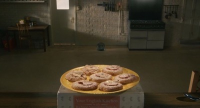

*"They're still warm."*

## Ingredients

| Ingredient | Grams |
|------------|-------|
| Unsalted butter, cut into small cubes | 450 |
| Gala apples | 5 (~900g) |
| Granulated sugar + ground cinnamon, for sprinkling | ~15 + 2 |

### Sugar mix bowl (step 2)

| Ingredient | Grams |
|------------|-------|
| Caster sugar | 100 |
| Brown sugar | 80 |
| Maple syrup | 40 |
| Fresh ginger, grated | 6 |

### Egg and vanilla bowl (step 3)

| Ingredient | Grams |
|------------|-------|
| Eggs, medium | 2 (100g) |
| Vanilla extract | 5 |

### Dry mix bowl (step 4)

| Ingredient | Grams |
|------------|-------|
| Plain (all-purpose) flour | 480 |
| Ground cinnamon | 5 |
| Ground ginger | 4 |
| Ground nutmeg | 2 |
| Ground cloves | 0.3 |
| Salt | 0.3 |

## Method

1. **Cream the butter** · 3 min

   Cream the cubed butter (**450g**) in the large bowl with a spatula or whisk until smooth.

   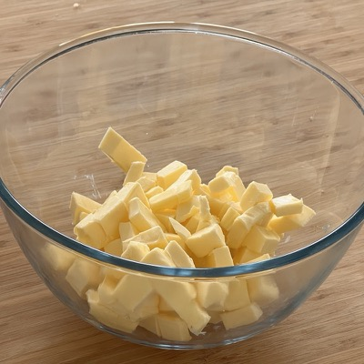
   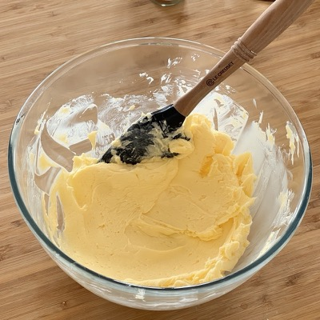

2. **Add the sugar mixture** · 3 min

   Add the sugar mix bowl to the butter and whisk together until fluffy.

   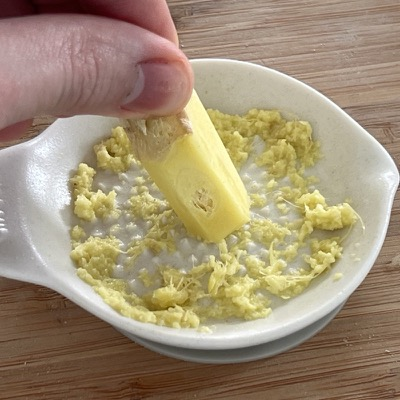
   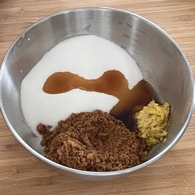
   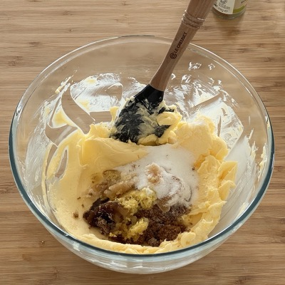
   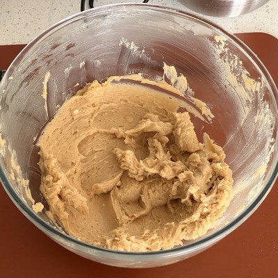

3. **Eggs and vanilla** · 2 min

   Add the egg and vanilla bowl. Beat until fully blended.

   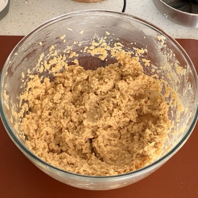

4. **Flour in thirds** · 5 min

   Whisk the dry mix bowl until evenly mixed, then add a third of it and mix until fully blended. Repeat twice more until it's all in.

   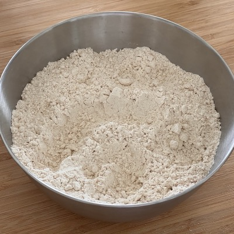
   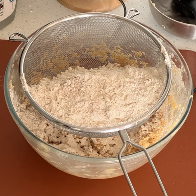
   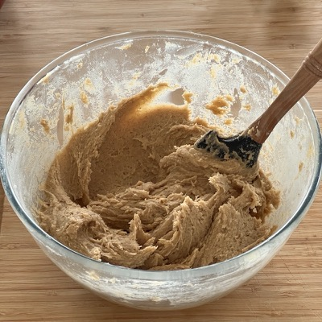

5. **Oven on, prep the apples** · 10 min

   Oven to 160°C. Wash the 5 gala apples (**~900g**), cut off tops and bottoms, and slice as thinly as you can — crosswise, so the star of the core shows in the middle of each slice.

   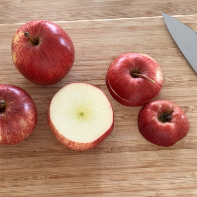
   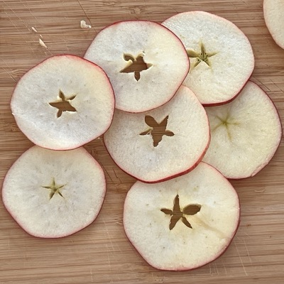

6. **Scoop, ball, press** · 15 min

   Scoop slightly more than a tablespoon of dough, shape into a ball on a lightly floured board, place on a lined baking tray and press down with an apple slice until the dough just peeks around the edges of the slice. Repeat until the dough is used up.

   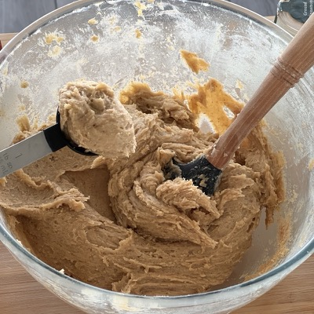
   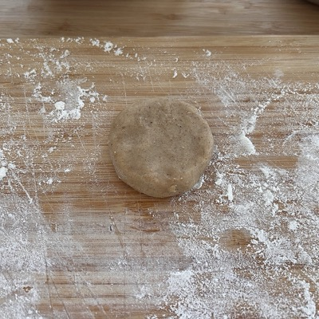
   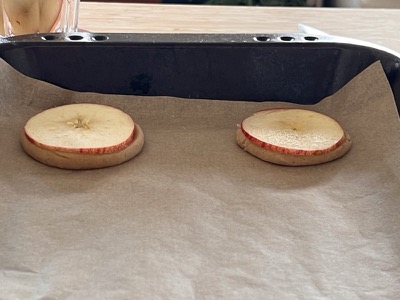
   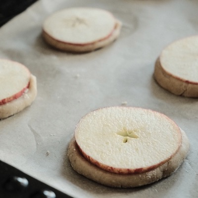

7. **Sprinkle** · 2 min

   Sprinkle each cookie with granulated sugar (**~15g** across the batch) and a little ground cinnamon (**~2g**).

   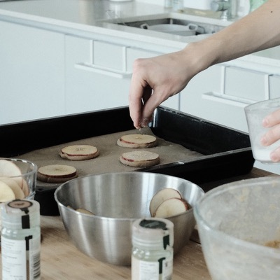

8. **Bake** · 15 min

   Into the oven for about 15 minutes, until browned at the edges.

   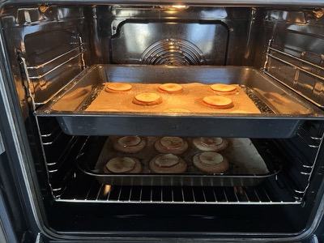

9. **Finish and cool** · 10 min

   Sprinkle a little extra granulated sugar over for decoration, then cool on a rack.

   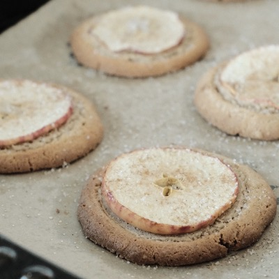
   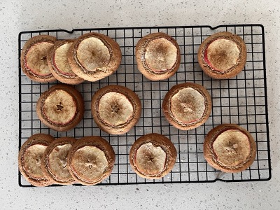
   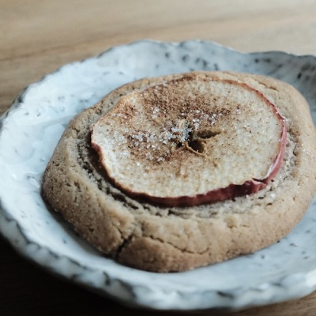

## Tips

- Slice the apples crosswise for the star — it's the whole look of the cookie.
- Ingredients scale cleanly to ¾ (butter 337g, flour 360g, caster 75g, brown 60g, maple 30g, 1½ eggs) — the original Notion tracker kept both columns.
- Press until the dough just peeks around the apple slice — that's the right thickness.

## Adjustment Log

- 2026-09-27: imported from Notion export with step photos. Used the full "Amount" column of the Notion ingredients table (¾-scale column noted in Tips). Eggs 2 medium ≈ 100g, 5 gala apples ≈ 900g; sprinkling sugar/cinnamon estimated (not in the Notion table). Photos compressed to max 400px.
- 2026-10-18: grouped same-time ingredients into named bowls under Ingredients (Sugar mix bowl, Egg and vanilla bowl, Dry mix bowl); steps refer to them by name. Quantities unchanged.
- 2026-10-18: removed the prep step and moved its photos into the steps they show; the bowls and the prep named in each ingredient row are done before step 1. Steps renumbered where needed. Quantities unchanged.
